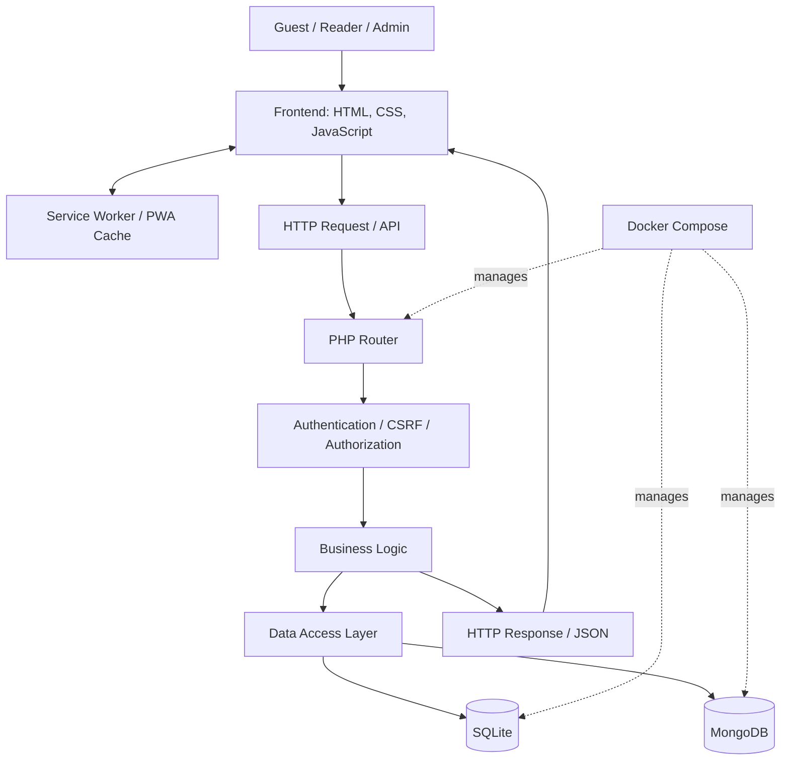
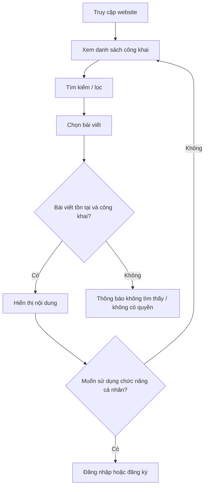
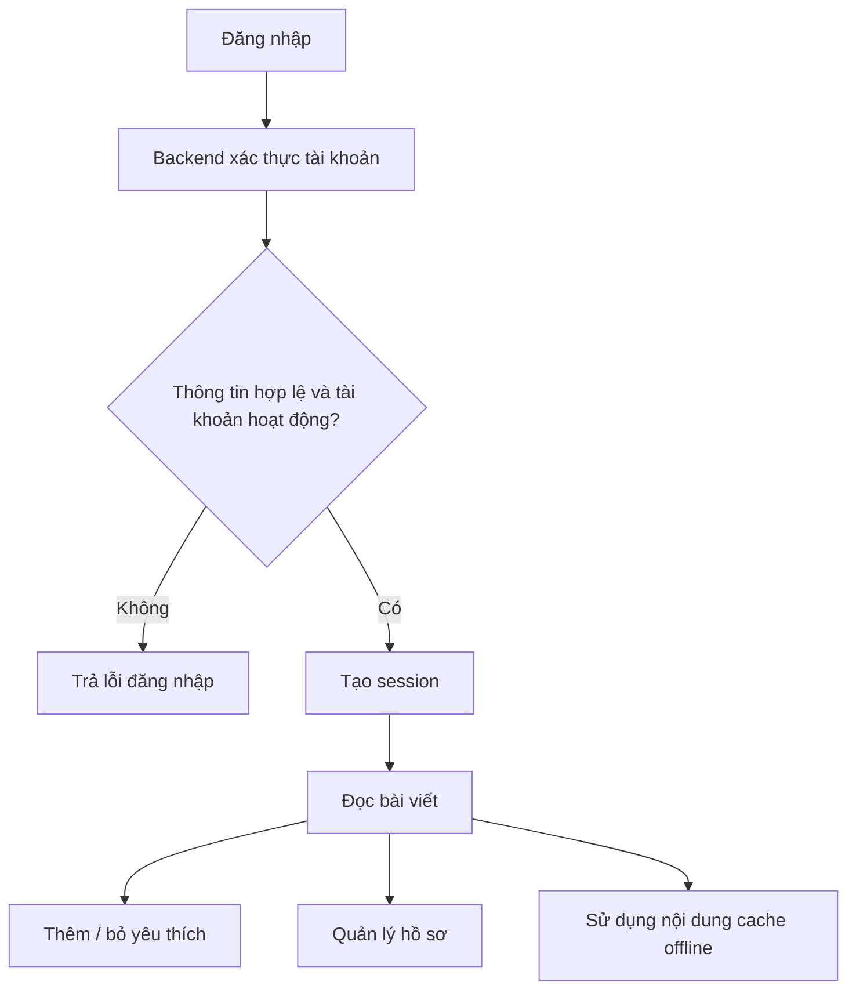
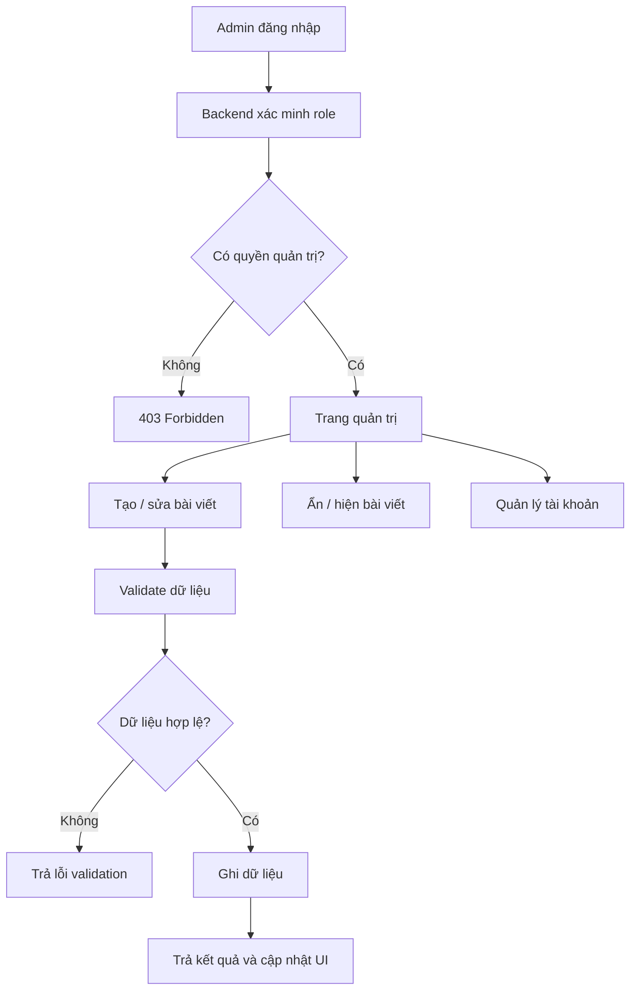

Genk Magazine
Website đọc báo và quản lý nội dung bài viết — Đồ án môn Lập trình Web.

Genk Magazine là ứng dụng web hướng đến trải nghiệm đọc tin trực tuyến, đồng thời cung cấp khu vực quản trị để quản lý nội dung và tài khoản. Dự án được tổ chức theo mô hình frontend–backend, sử dụng PHP ở phía máy chủ, HTML/CSS/JavaScript ở phía trình duyệt, SQLite và MongoDB cho lưu trữ dữ liệu, Docker Compose cho môi trường chạy và PWA/Service Worker cho một số khả năng hoạt động ngoại tuyến.
Trạng thái tài liệu: README này là bản tài liệu hóa kỹ thuật ban đầu. Các thành phần công nghệ và một số entrypoint dưới đây được xác định từ cấu hình triển khai đã khảo sát. Cây thư mục đầy đủ, mapping chính xác giữa từng bảng/collection, danh sách endpoint và lệnh test tự động cần được đối chiếu lại trực tiếp với toàn bộ repository trước khi xem đây là tài liệu đặc tả cuối cùng.

Mục lục
- 1. Mục tiêu và phạm vi
- 2. Chức năng hệ thống
- 3. Công nghệ sử dụng
- 4. Kiến trúc tổng thể
- 5. Cấu trúc và trách nhiệm mã nguồn
- 6. Luồng xử lý nghiệp vụ
- 7. Thiết kế và quản lý dữ liệu
- 8. Yêu cầu môi trường
- 9. Cài đặt và khởi chạy
- 10. Kiểm thử hệ thống
- 11. Bảo mật
- 12. PWA và chế độ ngoại tuyến
- 13. Hiệu năng và khả năng mở rộng
- 14. Logging, backup và phục hồi
- 15. Xử lý sự cố thường gặp
- 16. Quy trình phát triển và đóng góp
- 17. Giới hạn và hướng phát triển
- 18. Thông tin đồ án
1. Mục tiêu và phạm vi
1.1. Mục tiêu
- Xây dựng một website đọc tin có giao diện dễ sử dụng trên máy tính và thiết bị di động.
- Phân biệt rõ quyền và chức năng giữa khách truy cập, người đọc đã đăng nhập và quản trị viên.
- Cung cấp chức năng tìm kiếm, lọc, xem chi tiết và lưu bài viết yêu thích.
- Cho phép quản trị viên chủ động tạo, cập nhật và quản lý trạng thái hiển thị của bài viết.
- Quản lý tài khoản và hồ sơ người dùng.
- Hỗ trợ trải nghiệm ngoại tuyến đối với những tài nguyên/nội dung được Service Worker lưu cache theo chính sách của ứng dụng.
- Tạo môi trường triển khai có thể tái lập bằng Docker Compose.
1.2. Phạm vi quản lý nội dung
Quản trị viên là người chịu trách nhiệm nhập và quản lý bài viết trong hệ thống. README này không mô tả một quy trình duyệt bài tự động qua API bên ngoài, vì quy trình đó chưa được xác nhận là một phần của phạm vi triển khai hiện tại.
1.3. Đối tượng sử dụng
Đối tượng	Vai trò
Guest	Người chưa đăng nhập; truy cập và đọc nội dung công khai.
Reader	Người đã đăng nhập; sử dụng các chức năng cá nhân như yêu thích và quản lý hồ sơ.
Admin	Người quản trị; quản lý bài viết và tài khoản theo quyền được cấp.

2. Chức năng hệ thống
Danh sách dưới đây mô tả phạm vi chức năng của dự án. Mỗi chức năng cần được xác nhận bằng kiểm thử trên phiên bản mã nguồn được nghiệm thu.

2.1. Chức năng dành cho Guest
- Truy cập trang chủ và danh sách bài viết công khai.
- Xem thông tin và nội dung chi tiết của bài viết được phép công khai.
- Tìm kiếm và lọc bài viết theo các tiêu chí được giao diện hỗ trợ.
- Truy cập chức năng đăng ký và đăng nhập.
2.2. Chức năng dành cho Reader
- Đăng ký, đăng nhập và đăng xuất.
- Đọc bài viết và tìm kiếm nội dung.
- Thêm hoặc bỏ bài viết khỏi danh sách yêu thích.
- Xem và cập nhật hồ sơ cá nhân.
- Cập nhật ảnh đại diện nếu chức năng upload được bật.
- Tùy chỉnh giao diện theo các lựa chọn hệ thống cung cấp.
- Sử dụng nội dung ngoại tuyến đã được lưu cache, trong giới hạn chính sách PWA.
- Thực hiện quy trình đặt lại mật khẩu nếu được cấu hình.
2.3. Chức năng dành cho Admin
- Truy cập khu vực quản trị sau khi xác thực và kiểm tra quyền.
- Tạo bài viết mới.
- Chỉnh sửa thông tin và nội dung bài viết.
- Ẩn/hiện bài viết hoặc thay đổi trạng thái hiển thị.
- Quản lý tài khoản người dùng theo quyền được cấp, bao gồm khóa/mở khóa nếu chức năng tương ứng được triển khai.
2.4. Nguyên tắc nghiệp vụ
1. Guest chỉ được đọc nội dung công khai.
2. Reader chỉ được thao tác trên dữ liệu thuộc quyền của chính mình, trừ dữ liệu công khai.
3. Admin phải được xác minh quyền ở phía backend đối với mọi thao tác quản trị.
4. Ẩn bài viết phải ảnh hưởng nhất quán đến danh sách, tìm kiếm và trang chi tiết công khai.
5. Thao tác yêu thích phải tránh tạo bản ghi trùng cho cùng một Reader và một bài viết.
6. Trạng thái tài khoản bị khóa phải được backend kiểm tra, không chỉ ẩn chức năng trên giao diện.
7. Cache offline không được dùng thay thế cho xác thực hoặc phân quyền.
3. Công nghệ sử dụng
Lớp	Công nghệ	Vai trò
Frontend	HTML5	Cấu trúc nội dung giao diện.
Frontend	CSS	Trình bày, bố cục và responsive UI.
Frontend	JavaScript	Tương tác, gọi API và xử lý trạng thái phía trình duyệt.
Backend	PHP	Xử lý request, nghiệp vụ, xác thực và truy cập dữ liệu.
Database	SQLite	Một trong các hệ lưu trữ dữ liệu của ứng dụng.
Database	MongoDB 7.x image	Một trong các hệ lưu trữ dữ liệu của ứng dụng.
Container	Docker / Docker Compose	Tạo và vận hành môi trường ứng dụng cùng dịch vụ phụ trợ.
PWA	Web App Manifest / Service Worker	Cung cấp khả năng cài đặt và cache tài nguyên/nội dung phù hợp.
Authentication	PHP Session	Duy trì trạng thái đăng nhập phía máy chủ.
Security	CSRF protection / authorization middleware	Bảo vệ request thay đổi dữ liệu và kiểm soát quyền truy cập.

Lưu ý: Không suy ra rằng hai database có thể thay thế lẫn nhau hoặc cùng tham gia một transaction. Trách nhiệm cụ thể của từng database phải được xác định từ các repository/query và schema thực tế.
4. Kiến trúc tổng thể
4.1. Sơ đồ logic

Sơ đồ thể hiện các lớp trách nhiệm ở mức logic, không khẳng định tên class hoặc tên thư mục vật lý trong repository.
4.2. Luồng request cơ bản
1. Người dùng thao tác trên giao diện frontend.
2. JavaScript gửi request đến backend theo giao thức HTTP.
3. PHP router tiếp nhận và định tuyến request đến chức năng tương ứng.
4. Middleware hoặc lớp kiểm tra tương ứng xác minh session, CSRF token và quyền truy cập khi cần.
5. Lớp nghiệp vụ kiểm tra dữ liệu đầu vào và thực hiện quy tắc nghiệp vụ.
6. Lớp truy cập dữ liệu tương tác với SQLite hoặc MongoDB theo trách nhiệm của từng loại dữ liệu.
7. Backend trả response phù hợp; frontend cập nhật giao diện hoặc thông báo lỗi.
4.3. Ranh giới trách nhiệm
Thành phần	Trách nhiệm	Không nên đảm nhiệm
Frontend	Hiển thị dữ liệu, nhận thao tác, kiểm tra đầu vào cơ bản	Quyết định cuối cùng về quyền truy cập.
Router/API	Nhận request, định tuyến và chuẩn hóa response	Chứa toàn bộ nghiệp vụ phức tạp.
Middleware	Xác thực session, CSRF và quyền theo chính sách	Thay thế kiểm tra quyền trên từng tài nguyên.
Business logic	Thực thi quy tắc nghiệp vụ	Tự ý phụ thuộc vào chi tiết giao diện.
Data access	Đọc/ghi dữ liệu và ánh xạ kết quả	Bỏ qua kiểm tra dữ liệu hoặc quyền nghiệp vụ.
Database	Lưu trữ và bảo đảm ràng buộc dữ liệu	Tự quyết định luồng giao diện.
Service Worker	Cache và phục vụ tài nguyên phù hợp	Cấp quyền truy cập dữ liệu riêng tư.

5. Cấu trúc và trách nhiệm mã nguồn
5.1. Các entrypoint đã xác định từ cấu hình chạy
Các đường dẫn dưới đây được tham chiếu trong cấu hình khởi chạy đã khảo sát:
LapTrinhWeb_CK/
├── backend/
│   ├── router.php
│   └── Database/
│       └── scripts/
│           ├── setup.php
│           └── seed-demo.php
├── docker-compose.yml
└── README.md
Đây là danh sách entrypoint đã xác định, không phải cây thư mục đầy đủ. Các thư mục frontend, PWA, middleware, service, repository, cấu hình và tài nguyên tĩnh cần được bổ sung đúng tên sau khi đối chiếu trực tiếp toàn bộ mã nguồn.
5.2. Phân nhóm kiến trúc cần được duy trì
Nhóm	Trách nhiệm nên được đặt tại đây
Frontend / Views	Trang Guest, Reader, Admin và các component giao diện.
Frontend / Assets	CSS, JavaScript, hình ảnh, icon và font được cấp phép.
PWA	Manifest, Service Worker và chính sách cache.
Backend / Routing	Điểm vào ứng dụng, phân tích URL và điều phối request.
Backend / Middleware	Session, CSRF, authorization và kiểm tra request.
Backend / Controllers hoặc API handlers	Tiếp nhận dữ liệu request và trả response.
Backend / Services	Logic nghiệp vụ như tài khoản, bài viết, yêu thích.
Backend / Repositories hoặc Data Access	Truy vấn SQLite/MongoDB và ánh xạ dữ liệu.
Backend / Database	Khởi tạo schema, seed dữ liệu và script bảo trì.
Storage	File upload và dữ liệu bền vững cần lưu ngoài container.
Tests	Unit test, integration test và test nghiệp vụ nếu có.
Deployment	Dockerfile, Compose và cấu hình môi trường triển khai.

Các nhóm trên là khuyến nghị tổ chức mã nguồn, không phải cam kết rằng repository hiện tại đã có đủ các thư mục tương ứng.
5.3. Cách xuất cây thư mục thực tế
Chạy tại thư mục gốc repository để tạo cây thư mục phục vụ cập nhật README:

Linux / macOS
find . -maxdepth 4 -type f \
  -not -path './.git/*' \
  -not -path './node_modules/*' \
  -not -path './vendor/*' \
  | sort
Nếu đã cài tree:
tree -a -L 4 -I '.git|node_modules|vendor|storage|*.db'
Không đưa .env, mật khẩu, token, file database thực hoặc dữ liệu người dùng vào README hay commit công khai.
6. Luồng xử lý nghiệp vụ
6.1. Guest đọc bài viết

6.2. Reader thao tác cá nhân

6.3. Admin quản lý bài viết

6.4. Nguyên tắc xử lý lỗi xuyên tầng
- Backend phải trả mã HTTP và thông báo lỗi phù hợp với kết quả thực tế.
- Frontend không được hiển thị thông báo thành công trước khi backend xác nhận.
- Lỗi database phải được ghi log an toàn và trả thông báo không tiết lộ cấu hình nội bộ.
- Request lặp lại không được tạo dữ liệu trùng ngoài ý muốn.
- Khi thao tác gồm nhiều bước ghi vào hai database, cần có chiến lược xử lý ghi thất bại một phần, retry hoặc đối soát dữ liệu.
7. Thiết kế và quản lý dữ liệu
7.1. Hai hệ quản trị dữ liệu
Dự án sử dụng SQLite và MongoDB. Vai trò chính xác của từng bảng, collection và trường dữ liệu cần được mô tả theo schema và code truy vấn thực tế.

Khi tài liệu hóa data model, cần bổ sung:
Nội dung	Thông tin cần ghi nhận
SQLite	Đường dẫn database, danh sách bảng, khóa chính, khóa ngoại, unique/index.
MongoDB	Tên database, collection, document structure và index.
Mapping	ID liên kết giữa metadata và nội dung nếu dữ liệu được tách ở hai database.
Ownership	Database nào là nguồn dữ liệu chính của từng loại dữ liệu.
Consistency	Cách xử lý khi một thao tác chỉ ghi thành công ở một database.
Migration	Cách thay đổi schema và tương thích dữ liệu cũ.
Backup	Quy trình sao lưu và khôi phục nhất quán.

7.2. Ràng buộc dữ liệu cần bảo đảm
- Tài khoản phải có định danh duy nhất; email/username cần có chính sách uniqueness rõ ràng.
- Mỗi cặp Reader–Article chỉ có tối đa một bản ghi yêu thích.
- Bài viết công khai phải có đủ dữ liệu bắt buộc để hiển thị.
- Trạng thái bài viết phải được kiểm tra ở backend khi truy vấn công khai.
- Dữ liệu tham chiếu đến tài khoản hoặc bài viết phải được kiểm tra tính tồn tại.
- Dữ liệu upload phải có tên lưu trữ an toàn, không tin tưởng tên file do client gửi.
- Ngày giờ nên thống nhất cách lưu và cách hiển thị múi giờ.
7.3. Dữ liệu mẫu
Script backend/Database/scripts/seed-demo.php được tham chiếu trong cấu hình khởi chạy để nạp dữ liệu demo. Trước khi sử dụng ở môi trường có dữ liệu thật, cần bảo đảm script:
- Có thể chạy lặp lại mà không nhân đôi dữ liệu ngoài ý muốn (idempotent), hoặc có cơ chế chỉ chạy khi khởi tạo môi trường mới.
- Không xóa hoặc ghi đè dữ liệu người dùng.
- Không tạo tài khoản quản trị với mật khẩu mặc định có thể sử dụng ở môi trường production.
- Không nạp dữ liệu demo khi APP_ENV=production.
8. Yêu cầu môi trường
8.1. Công cụ cần có
- Git để lấy mã nguồn.
- Docker Engine hoặc Docker Desktop.
- Docker Compose plugin (docker compose).
- Trình duyệt hiện đại như Firefox, Chrome hoặc Edge.
Nếu chạy kiểm tra PHP trực tiếp trên máy host, cần cài PHP tương thích với mã nguồn. Phiên bản PHP chính xác nên được xác định từ Dockerfile hoặc cấu hình dependency của repository trước khi công bố.
8.2. Kiểm tra Docker
docker --version
docker compose version
9. Cài đặt và khởi chạy
9.1. Lấy mã nguồn
git clone https://github.com/datnguyen3406/LapTrinhWeb_CK.git
cd LapTrinhWeb_CK
9.2. Kiểm tra cấu hình Compose
docker compose config
Lệnh này kiểm tra cấu hình Compose có hợp lệ trước khi tạo container. Không chia sẻ output nếu trong cấu hình có thông tin nhạy cảm.
9.3. Khởi chạy ứng dụng
docker compose up --build -d
Theo cấu hình chạy đã khảo sát, container ứng dụng thực hiện các bước khởi tạo database, nạp dữ liệu demo và khởi chạy PHP built-in server với router backend/router.php trên cổng nội bộ 8000.

Địa chỉ truy cập từ máy host phụ thuộc vào phần ánh xạ ports trong docker-compose.yml. Hãy kiểm tra cấu hình thực tế hoặc chạy:
docker compose ps
Sau đó mở địa chỉ host/port được công bố tại cột PORTS.
9.4. Xem log
docker compose logs -f
Hoặc xem log của một service cụ thể sau khi xác định tên service trong Compose:
docker compose logs -f <service-name>
9.5. Dừng ứng dụng
docker compose down
Lệnh trên dừng và xóa container/network do Compose tạo, nhưng thông thường không xóa named volume.
Cảnh báo: docker compose down -v có thể xóa volume chứa dữ liệu bền vững. Không chạy lệnh này khi chưa sao lưu và chưa hiểu rõ tác động.

9.6. Khởi tạo dữ liệu
Các script setup và seed được gọi trong quy trình khởi động đã khảo sát. Không chạy thủ công nhiều lần trước khi kiểm tra tính idempotent và tác động của script lên dữ liệu hiện có.
9.7. Cấu hình môi trường
- Không commit .env chứa secret.
- Dùng biến môi trường riêng cho development, test và production.
- Không dùng mật khẩu mặc định hoặc tài khoản demo ở production.
- Không đưa cổng database ra Internet công khai.
- Chỉ bật chế độ debug ở môi trường phát triển.
10. Kiểm thử hệ thống
10.1. Mục tiêu kiểm thử
Kiểm thử phải xác nhận đồng thời ba khía cạnh:
1. Đúng chức năng: thao tác trả về kết quả phù hợp yêu cầu.
2. Đúng quyền: người dùng không thể vượt qua giới hạn vai trò hoặc truy cập dữ liệu người khác.
3. Đúng dữ liệu: trạng thái frontend, backend và database không mâu thuẫn.
10.2. Kiểm tra tĩnh và kiểm tra môi trường
Kiểm tra cấu hình Docker:
docker compose config
docker compose ps
docker compose logs --tail=200
Kiểm tra cú pháp PHP trên máy host (cần cài PHP và chạy từ thư mục gốc):
find backend -type f -name '*.php' -print0 | xargs -0 -n1 php -l
Lệnh này chỉ kiểm tra cú pháp PHP, không thay thế unit test, integration test hoặc kiểm thử nghiệp vụ.

Kiểm tra route và HTTP:
- Dùng Developer Tools của trình duyệt để xem request, response, mã HTTP và lỗi JavaScript.
- Kiểm tra Content-Type, response body và hành vi khi request lỗi.
- Chỉ dùng endpoint thực tế được khai báo trong router; không tự suy đoán URL API.
README hiện không công bố lệnh PHPUnit/Pest vì chưa xác minh được test runner và cấu hình dependency của repository. Nếu dự án có test suite, cần bổ sung lệnh chính xác từ cấu hình thực tế.
10.3. Ma trận kiểm thử chức năng
ID	Vai trò	Kịch bản	Kết quả mong đợi
TC-AUTH-01	Guest	Đăng ký bằng dữ liệu hợp lệ	Tạo tài khoản hoặc thông báo thành công đúng quy trình.
TC-AUTH-02	Guest	Đăng ký email/username trùng	Backend từ chối và không tạo bản ghi trùng.
TC-AUTH-03	Guest	Đăng nhập sai mật khẩu	Không tạo session đăng nhập.
TC-AUTH-04	Reader	Đăng xuất rồi truy cập trang riêng tư	Backend từ chối; giao diện chuyển về trạng thái chưa đăng nhập.
TC-GUEST-01	Guest	Mở bài viết công khai	Hiển thị đúng nội dung.
TC-GUEST-02	Guest	Mở bài viết ẩn/không tồn tại	Không trả nội dung riêng tư hoặc đã ẩn.
TC-SEARCH-01	Guest/Reader	Tìm kiếm tiếng Việt có dấu	Kết quả phù hợp và không lỗi encoding.
TC-READER-01	Reader	Thêm bài vào yêu thích	Bài xuất hiện trong danh sách yêu thích.
TC-READER-02	Reader	Thêm yêu thích lặp lại	Không tạo bản ghi trùng.
TC-READER-03	Reader	Thử sửa/xem dữ liệu cá nhân người khác	Backend từ chối.
TC-ADMIN-01	Admin	Tạo bài viết hợp lệ	Bài được lưu và hiển thị theo trạng thái đã chọn.
TC-ADMIN-02	Reader	Gọi trực tiếp chức năng Admin	Backend trả 401/403 phù hợp.
TC-ADMIN-03	Admin	Ẩn bài viết	Bài không còn xuất hiện ở các truy vấn công khai.
TC-ADMIN-04	Admin	Gửi dữ liệu thiếu trường bắt buộc	Validation từ chối; không lưu dữ liệu lỗi.
TC-DATA-01	System	Một database ghi thành công, database còn lại thất bại	Có xử lý lỗi/đối soát; không âm thầm báo thành công.
TC-PWA-01	Reader	Mở tài nguyên đã cache khi offline	Chỉ tài nguyên được phép cache được phục vụ.
TC-PWA-02	Reader	Logout rồi dùng nút Back khi offline	Không lộ dữ liệu cá nhân đã cache.
TC-UPLOAD-01	Reader	Upload file sai định dạng hoặc quá lớn	Backend từ chối và không lưu file nguy hiểm.

10.4. Kiểm thử bảo mật
ID	Kiểu kiểm thử	Cách thực hiện	Kết quả mong đợi
SEC-01	Broken Access Control	Reader gửi request tới chức năng Admin	Bị từ chối ở backend.
SEC-02	IDOR	Thay ID tài nguyên của mình thành ID người khác	Không đọc/sửa được dữ liệu không thuộc quyền.
SEC-03	SQL Injection	Thử chuỗi đầu vào bất thường trong form tìm kiếm/đăng nhập	Không làm thay đổi cấu trúc câu truy vấn.
SEC-04	XSS	Nhập payload HTML/JavaScript vào trường nội dung	Nội dung được xử lý an toàn khi hiển thị.
SEC-05	CSRF	Gửi request thay đổi dữ liệu thiếu/sai token	Backend từ chối.
SEC-06	Session	Đăng nhập, đăng xuất, hết hạn session	Session được quản lý đúng; session cũ không còn quyền.
SEC-07	Upload	Thử MIME giả, extension kép, file quá lớn	File không hợp lệ bị từ chối.
SEC-08	Secret exposure	Kiểm tra repository, log và response lỗi	Không lộ mật khẩu, token hoặc cấu hình bí mật.
SEC-09	Brute force	Gửi nhiều lần đăng nhập sai	Có giới hạn/tạm hoãn phù hợp nếu cơ chế được triển khai.

Chỉ thực hiện kiểm thử trên môi trường và dữ liệu mà nhóm có quyền kiểm soát.
10.5. Kiểm thử tích hợp và nhất quán dữ liệu
- Tạo bài viết và xác minh metadata/nội dung tại đúng database.
- Sửa bài viết và xác minh danh sách, trang chi tiết và tìm kiếm cùng phản ánh dữ liệu mới.
- Ẩn bài viết và xác minh tất cả đường truy cập công khai.
- Xóa hoặc khóa tài khoản và xác minh session/API liên quan.
- Mô phỏng MongoDB hoặc SQLite không khả dụng trong lúc ghi dữ liệu.
- Khởi động lại container và xác minh dữ liệu còn nguyên trong persistent volume.
- Kiểm tra seed nhiều lần để xác định có tạo dữ liệu demo trùng hay không.
10.6. Kiểm thử hiệu năng
Đo trong môi trường có cấu hình phần cứng và dữ liệu xác định. Ghi lại:
- Thời gian phản hồi API (p50, p95, p99).
- Tỷ lệ request lỗi.
- Throughput (request/giây).
- CPU và RAM của app/database.
- Thời gian truy vấn SQLite/MongoDB.
- Thời gian tải trang và ảnh ở frontend.
Các kịch bản nên bao gồm danh sách bài viết lớn, tìm kiếm liên tục, nhiều người dùng đồng thời và upload file. Không kết luận hệ thống đạt tải dựa trên một lần mở trang thủ công.
10.7. Biên bản kết quả kiểm thử
Với mỗi test case, ghi lại:
Trường	Nội dung
Test ID	Mã test case.
Build/Commit	Phiên bản code được kiểm thử.
Môi trường	OS, Docker, PHP, database và trình duyệt.
Dữ liệu đầu vào	Request hoặc dữ liệu sử dụng.
Kết quả mong đợi	Hành vi đúng theo yêu cầu.
Kết quả thực tế	Kết quả quan sát được.
Trạng thái	Pass / Fail / Blocked / Not Run.
Evidence	Screenshot, log hoặc request/response đã ẩn dữ liệu nhạy cảm.
Issue	Mô tả lỗi và mức độ ưu tiên.

11. Bảo mật
Các mục dưới đây là tiêu chí bảo mật cần duy trì và kiểm thử; không nên hiểu là mọi mục đã được xác minh hoàn chỉnh chỉ vì dự án có middleware tương ứng.
11.1. Xác thực và session
- Mật khẩu phải được băm bằng password_hash() và xác minh bằng password_verify(); không lưu plaintext hoặc mã hóa có thể giải ngược để thay thế hashing.
- Regenerate session ID sau khi đăng nhập hoặc thay đổi trạng thái xác thực quan trọng.
- Cookie session nên bật HttpOnly, Secure khi chạy HTTPS và SameSite phù hợp.
- Hủy session phía máy chủ khi đăng xuất.
- Có chính sách hết hạn session và xử lý tài khoản bị khóa.
- Quy trình đặt lại mật khẩu phải sử dụng token khó đoán, có thời hạn và chỉ dùng một lần.
11.2. Phân quyền
- Kiểm tra quyền tại backend trên mọi endpoint nhạy cảm.
- Không dựa vào việc ẩn nút hoặc ẩn trang ở frontend.
- Kiểm tra quyền sở hữu tài nguyên để phòng IDOR.
- Các thao tác đổi role, khóa tài khoản hoặc quản lý nội dung cần có kiểm soát phù hợp.
11.3. Bảo vệ dữ liệu đầu vào và đầu ra
- Dùng prepared statements cho truy vấn SQL.
- Kiểm soát kiểu dữ liệu và cấu trúc truy vấn với MongoDB; không đưa trực tiếp input không tin cậy vào query operator.
- Escape dữ liệu theo ngữ cảnh khi render HTML để hạn chế XSS.
- Kiểm tra độ dài, kiểu và miền giá trị của input ở backend.
- Không hiển thị stack trace hoặc thông tin nội bộ cho người dùng cuối.
11.4. CSRF và upload
- Request thay đổi trạng thái cần được bảo vệ CSRF khi sử dụng cookie/session authentication.
- Kiểm tra MIME thực tế, kích thước, phần mở rộng và nội dung file upload.
- Đổi tên file bằng tên do hệ thống sinh; không dùng nguyên tên file client gửi làm đường dẫn lưu.
- Không cho phép file thực thi được chạy trực tiếp trong vùng upload.
- Hạn chế quyền ghi và quyền đọc thư mục lưu file.
11.5. Docker và secret
- Không commit mật khẩu database, secret, token hoặc private key.
- Không expose MongoDB/SQLite storage ra Internet nếu không có nhu cầu và kiểm soát rõ ràng.
- Dùng tài khoản database có quyền tối thiểu cần thiết.
- Tách cấu hình development và production.
- Dùng web server phù hợp cho production; PHP built-in server chỉ nên dùng trong môi trường phát triển/kiểm thử giới hạn.
12. PWA và chế độ ngoại tuyến
PWA/Service Worker có thể cache tài nguyên tĩnh và một phần nội dung để cải thiện trải nghiệm khi mất kết nối. Việc cache phải tuân thủ chính sách dữ liệu của ứng dụng.
12.1. Các loại cache cần phân biệt
Nhóm	Chính sách cần xác định
Static assets	Có thể cache theo phiên bản và cập nhật khi phát hành mới.
Public articles	Chỉ cache nội dung công khai theo chiến lược đã chọn.
User-specific data	Không đưa vào cache dùng chung; phải gắn với chính sách tài khoản/session.
Authentication responses	Không cache response nhạy cảm.
API responses	Chọn chiến lược riêng theo độ nhạy và mức độ cập nhật dữ liệu.

12.2. Các tình huống phải kiểm thử
- Lần truy cập đầu tiên khi có Internet.
- Truy cập lại khi offline.
- Cập nhật Service Worker và xóa cache phiên bản cũ.
- Bài viết bị ẩn/xóa sau khi đã cache.
- Reader đăng xuất rồi chuyển sang offline.
- Nhiều tài khoản dùng chung một trình duyệt.
- API trả lỗi hoặc dữ liệu hết hạn.
Không cam kết rằng nội dung đã cache sẽ được thu hồi tức thời khi thiết bị offline. Cần mô tả rõ chính sách cache và giới hạn đồng bộ khi kết nối trở lại.
13. Hiệu năng và khả năng mở rộng
13.1. Backend và database
- Phân trang ở backend thay vì tải toàn bộ bài viết.
- Chỉ truy vấn trường dữ liệu cần thiết.
- Tạo index cho các trường thường dùng để lọc, tìm kiếm và liên kết.
- Kiểm tra truy vấn lặp/N+1.
- Đặt giới hạn hợp lý cho page size, request body và upload size.
- Tránh giữ transaction hoặc khóa dữ liệu lâu hơn cần thiết.
- Đo riêng chi phí truy vấn SQLite và MongoDB.
13.2. Frontend
- Tối ưu kích thước ảnh và dùng lazy loading khi phù hợp.
- Tránh tải hoặc render lượng lớn bài viết cùng lúc.
- Debounce thao tác tìm kiếm liên tục.
- Giảm JavaScript/CSS không dùng.
- Có trạng thái loading, empty, success và error rõ ràng.
13.3. Nguyên tắc đo lường
Mọi tuyên bố về tốc độ hoặc khả năng chịu tải phải đi kèm môi trường đo, số lượng dữ liệu, số người dùng đồng thời, thời gian chạy và kết quả thống kê. Không dùng các con số hiệu năng chưa đo được trong phần giới thiệu dự án.
14. Logging, backup và phục hồi
14.1. Logging
Log nên ghi nhận thời điểm, loại sự kiện, mã request, kết quả và thông tin định danh cần thiết ở mức tối thiểu. Không ghi mật khẩu, session ID, token reset, cookie hoặc dữ liệu cá nhân nhạy cảm.

Các sự kiện cần theo dõi:
- Đăng nhập thành công/thất bại và sự kiện đăng xuất.
- Thay đổi trạng thái tài khoản.
- Tạo, sửa, ẩn/hiện bài viết.
- Lỗi truy vấn hoặc lỗi kết nối database.
- Lỗi upload và lỗi xử lý PWA/API.
14.2. Backup
Cần có kế hoạch sao lưu riêng cho:
- SQLite database file.
- MongoDB database/volume.
- File upload như avatar và ảnh nội dung.
- Cấu hình triển khai không chứa secret, hoặc bản cấu hình đã được làm sạch.
Do ứng dụng sử dụng hơn một loại lưu trữ, backup cần có timestamp và quy trình khôi phục phối hợp để tránh phục hồi các thành phần về những thời điểm không tương thích.
14.3. Khôi phục
Quy trình restore phải được thử định kỳ trên môi trường riêng:
1. Dừng hoặc đưa ứng dụng vào chế độ bảo trì.
2. Khôi phục bản backup phù hợp của từng thành phần dữ liệu.
3. Kiểm tra kết nối và schema.
4. Đối soát metadata, nội dung bài viết và file liên quan.
5. Chạy smoke test các luồng đọc, đăng nhập và quản trị.
6. Mở lại ứng dụng sau khi xác nhận dữ liệu nhất quán.
15. Xử lý sự cố thường gặp
Hiện tượng	Nguyên nhân cần kiểm tra	Hướng xử lý
Container không khởi động	Compose sai, port xung đột, image/build lỗi	Chạy docker compose config, docker compose ps và xem log.
App không kết nối database	Database chưa sẵn sàng, sai host/credential, sai network	Kiểm tra log app và database; xác nhận hostname theo service name trong Compose.
Không truy cập được website	Port chưa publish hoặc truy cập sai port	Kiểm tra cột PORTS bằng docker compose ps.
Mất dữ liệu sau khi tạo lại container	Dữ liệu không nằm trong persistent volume hoặc volume bị xóa	Kiểm tra volume mapping và quy trình backup.
Bài viết hiển thị thiếu nội dung	Metadata và content store không đồng bộ	Đối soát SQLite/MongoDB và log thao tác ghi.
Đăng nhập liên tục thất bại	Sai thông tin, session/cookie hoặc cấu hình ứng dụng	Kiểm tra response, cookie và log; không ghi mật khẩu vào log.
PWA không cập nhật giao diện	Service Worker đang dùng cache cũ	Kiểm tra version cache và vòng đời cập nhật Service Worker.
Upload thất bại	Quyền thư mục, giới hạn file, MIME hoặc dung lượng	Kiểm tra cấu hình upload và log backend.

16. Quy trình phát triển và đóng góp
16.1. Quy trình đề xuất
1. Tạo branch riêng cho mỗi tính năng hoặc bản sửa lỗi.
2. Giữ thay đổi tập trung vào một mục tiêu.
3. Kiểm tra cú pháp và chạy test liên quan trước khi commit.
4. Kiểm tra phân quyền và tác động dữ liệu đối với mọi API mới.
5. Cập nhật README/schema/test khi thay đổi kiến trúc hoặc nghiệp vụ.
6. Tạo Pull Request hoặc review thay đổi trước khi merge vào nhánh chính.
16.2. Quy ước commit đề xuất
feat: add article management
fix: prevent duplicate favorites
security: enforce admin authorization
refactor: separate article data access
test: cover reader access flow
docs: update setup and testing guide
16.3. Definition of Done
Một chức năng chỉ được xem là hoàn thành khi:
- Đáp ứng đúng yêu cầu nghiệp vụ.
- Có validation phía backend.
- Có kiểm tra quyền phù hợp.
- Xử lý được trạng thái loading, lỗi và dữ liệu rỗng ở frontend.
- Không tạo dữ liệu sai/trùng.
- Có test hoặc bằng chứng kiểm thử.
- Tài liệu được cập nhật nếu có thay đổi cách chạy hoặc cấu trúc.
17. Giới hạn và hướng phát triển
17.1. Các giới hạn cần đánh giá
- Việc phối hợp hai database làm tăng độ phức tạp của transaction, backup và đối soát dữ liệu.
- PHP built-in server không phải cấu hình phù hợp cho production.
- Cache offline có giới hạn về tính cập nhật và khả năng thu hồi nội dung khi thiết bị mất mạng.
- Khả năng chịu tải cần được đo bằng benchmark; không thể suy ra chỉ từ việc ứng dụng chạy được bằng Docker.
- Cần có test tự động và pipeline kiểm tra để giảm rủi ro hồi quy.
17.2. Hướng phát triển
- Hoàn thiện tài liệu API và schema dữ liệu.
- Tăng độ bao phủ unit test, integration test và end-to-end test.
- Chuẩn hóa xử lý lỗi và response giữa frontend/backend.
- Bổ sung cơ chế đối soát dữ liệu giữa SQLite và MongoDB.
- Hoàn thiện logging, monitoring và backup/restore.
- Tối ưu phân trang, index, truy vấn và tải tài nguyên frontend.
- Tăng cường kiểm soát bảo mật cho session, CSRF, upload và cache offline.
- Bổ sung quy trình triển khai production với web server, HTTPS và secret management phù hợp.
18. Thông tin đồ án
Thuộc tính	Thông tin
Tên dự án	Genk Magazine
Loại dự án	Website đọc báo và quản lý nội dung
Học phần	Lập trình Web
Repository	https://github.com/datnguyen3406/LapTrinhWeb_CK
Backend	PHP
Frontend	HTML, CSS, JavaScript
Database	SQLite, MongoDB
Deployment	Docker Compose
PWA	Web App Manifest / Service Worker

Ghi nhận và đóng góp
Mọi đóng góp nên đi kèm mô tả vấn đề, cách tái hiện, kết quả mong đợi và kết quả thực tế.
