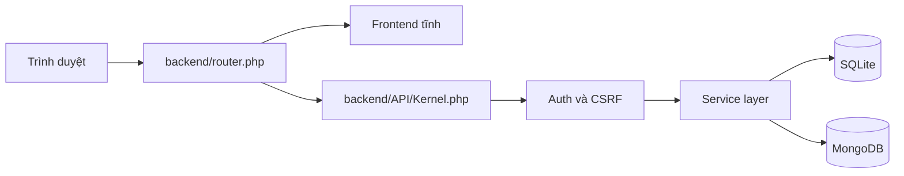

# Genk Magazine

Website đọc báo và hệ thống quản lý nội dung cho Guest, Reader và Admin.

## 1. Tổng quan

Genk Magazine gồm:

- Trang đọc tin công khai.
- Đăng ký, đăng nhập, đăng xuất và khôi phục mật khẩu.
- Hồ sơ, avatar, tùy chọn giao diện, yêu thích và lịch sử đọc.
- Quản lý tài khoản, nguồn tin, danh mục, bài viết và nhật ký hoạt động.
- PWA với manifest, service worker và trang fallback ngoại tuyến.
- Docker Compose chạy PHP, SQLite và MongoDB.

## 2. Công nghệ

| Lớp | Công nghệ |
|---|---|
| Frontend | HTML5, CSS3, JavaScript |
| Backend | PHP 8.3 |
| Database chính | SQLite |
| Database nội dung/audit | MongoDB 7 |
| Triển khai | Docker, Docker Compose |
| PWA | Web App Manifest, Service Worker |

## 3. Kiến trúc



- Frontend gửi request HTTP/JSON đến `/api/...`.
- `router.php` định tuyến API và phục vụ file tĩnh.
- `Kernel.php` điều phối route, middleware và service.
- Service chứa nghiệp vụ.
- Repository truy vấn SQLite hoặc MongoDB.
- SQLite lưu tài khoản, metadata bài viết, yêu thích và lịch sử.
- MongoDB lưu nội dung bài viết, danh mục, nguồn tin, media và nhật ký.

## 4. Cấu trúc thư mục

```text
LapTrinhWeb_CK/
├── backend/
│   ├── router.php
│   ├── API/
│   ├── Database/
│   ├── Middleware/
│   ├── Service/
│   ├── store/
│   └── tests/
├── frontend/
│   ├── assets/
│   ├── pages/
│   ├── manifest.webmanifest
│   ├── offline.html
│   └── service-worker.js
├── tests/
│   ├── test_api.py
│   └── KICH_BAN_TEST.md
├── Dockerfile
├── docker-compose.yml
└── README.md
```

## 5. Vai trò các thư mục và file

### 5.1. Backend

| Đường dẫn | Vai trò |
|---|---|
| `backend/router.php` | Router chính: chuyển `/api/*` sang API, phục vụ trang và tài nguyên frontend, trả 404 khi không khớp. |
| `backend/API/index.php` | Bootstrap API, bắt session và lỗi, gọi `Kernel`. |
| `backend/API/bootstrap.php` | Tự nạp class theo namespace `App`, khởi tạo session và cấu hình dự án. |
| `backend/API/Kernel.php` | Khai báo toàn bộ endpoint, xác thực CSRF, phân quyền và điều phối service. |
| `backend/API/Http/Request.php` | Chuẩn hóa method, path, query, JSON body, header và multipart file. |
| `backend/API/Http/Response.php` | Trả JSON, file media và HTTP status chuẩn. |
| `backend/API/Http/ApiException.php` | Exception HTTP có mã nghiệp vụ và mã lỗi. |

### 5.2. Middleware

| Đường dẫn | Vai trò |
|---|---|
| `backend/Middleware/AuthMiddleware.php` | Kiểm tra CSRF, session, tài khoản khóa, quyền Reader/Admin và tài khoản hiện tại. |

### 5.3. Service

| Đường dẫn | Vai trò |
|---|---|
| `backend/Service/AuthService.php` | Đăng ký, đăng nhập, đăng xuất, session, đổi/khôi phục mật khẩu và mã khôi phục. |
| `backend/Service/AccountService.php` | Hồ sơ, avatar, tùy chọn giao diện và đổi mật khẩu. |
| `backend/Service/ReaderService.php` | Yêu thích, lịch sử đọc và phân loại cá nhân. |
| `backend/Service/ArticleService.php` | Tạo/sửa/xóa bài viết, trạng thái xuất bản và luồng đồng bộ nội dung. |
| `backend/Service/ArticleIntegrityService.php` | Kiểm tra tính toàn vẹn metadata SQLite và nội dung MongoDB. |
| `backend/Service/CategoryService.php` | Nghiệp vụ danh mục, validation và kiểm tra danh mục còn bài viết. |
| `backend/Service/AdminService.php` | Dashboard, người dùng, nguồn tin, nhật ký và báo cáo reconciliation. |
| `backend/Service/AuditLogService.php` | Ghi nhật ký hoạt động và che dữ liệu nhạy cảm. |

### 5.4. Database

| Đường dẫn | Vai trò |
|---|---|
| `backend/Database/Environment.php` | Đọc biến môi trường từ `.env`/environment và cung cấp cấu hình chung. |
| `backend/Database/SqliteDatabase.php` | Mở SQLite, bật foreign key/WAL và chạy schema/migration. |
| `backend/Database/UsersRepository.php` | Tài khoản, role, khóa/mở tài khoản, session và mã khôi phục. |
| `backend/Database/ReaderRepository.php` | Yêu thích, lịch sử đọc và phân loại cá nhân. |
| `backend/Database/ArticlesRepository.php` | Metadata bài viết, revision, trạng thái xuất bản và truy vấn công khai/Admin. |
| `backend/Database/CategoriesRepository.php` | CRUD danh mục SQLite và đếm bài viết đang liên kết. |
| `backend/Database/MongoDatabase.php` | Wrapper MongoDB cho query, command, insert, update, delete và GridFS. |
| `backend/Database/MongoContentRepository.php` | Nội dung bài viết, category/source, media và activity log trên MongoDB. |
| `backend/Database/migrations/` | Migration bổ sung API, session, username, bài viết/danh mục và bookmark/history. |
| `backend/Database/schemas/sqlite/` | SQL tạo bảng, index, trigger và migration cơ sở. |
| `backend/Database/scripts/setup.php` | Khởi tạo schema SQLite, collection/validator/index MongoDB. |
| `backend/Database/scripts/seed-demo.php` | Tạo tài khoản Admin và dữ liệu demo khi chạy development. |
| `backend/Database/scripts/create-admin.php` | Tạo hoặc cập nhật tài khoản Admin bằng CLI. |
| `backend/Database/data/news_reader.sqlite` | File dữ liệu SQLite trong development. |
| `backend/store/uploads/` | Tệp lưu trữ ứng dụng; avatar sử dụng thư mục `avatars/`. |

### 5.5. Frontend

| Đường dẫn | Vai trò |
|---|---|
| `frontend/pages/index.html` | Trang chủ danh sách bài viết công khai. |
| `frontend/pages/Auth.html` | Đăng nhập. |
| `frontend/pages/Register.html` | Đăng ký Reader. |
| `frontend/pages/ForgetPassword.html` | Khôi phục mật khẩu. |
| `frontend/pages/Read.html` | Trang chi tiết bài viết. |
| `frontend/pages/User/Reader.html` | Trung tâm Reader và lịch sử. |
| `frontend/pages/User/Profile.html` | Hồ sơ người dùng. |
| `frontend/pages/User/Favourite.html` | Danh sách yêu thích. |
| `frontend/pages/User/Appearance.html` | Cỡ chữ và theme. |
| `frontend/pages/User/ChangePassword.html` | Đổi mật khẩu. |
| `frontend/pages/Admin/Dashboard.html` | Dashboard quản trị. |
| `frontend/pages/Admin/Article.html` | CRUD bài viết. |
| `frontend/pages/Admin/ManageUser.html` | Quản lý tài khoản và role. |
| `frontend/pages/Admin/SourceNews.html` | Quản lý nguồn tin. |
| `frontend/pages/Admin/History.html` | Nhật ký hoạt động. |
| `frontend/assets/css/style.css` | CSS toàn ứng dụng, bố cục và responsive. |
| `frontend/assets/js/api.js` | Wrapper fetch, CSRF, session và xử lý response API. |
| `frontend/assets/js/index.js` | Hiển thị trang chủ và danh sách. |
| `frontend/assets/js/article_detail.js` | Hiển thị chi tiết bài viết. |
| `frontend/assets/js/article_content.js` | Render block, URL ảnh và video. |
| `frontend/assets/js/auth.js` | Luồng đăng nhập/đăng xuất. |
| `frontend/assets/js/register.js` | Luồng đăng ký. |
| `frontend/assets/js/recover_code.js` | Khôi phục mật khẩu bằng mã. |
| `frontend/assets/js/profile.js` | Cập nhật hồ sơ/avatar. |
| `frontend/assets/js/change-password.js` | Đổi mật khẩu. |
| `frontend/assets/js/appearance.js` | Cấu hình giao diện. |
| `frontend/assets/js/favorites.js` | Thêm/bỏ và hiển thị yêu thích. |
| `frontend/assets/js/reader.js` | Danh sách/lịch sử Reader. |
| `frontend/assets/js/admin_*.js` | JavaScript riêng cho từng trang quản trị. |
| `frontend/manifest.webmanifest` | Metadata PWA. |
| `frontend/service-worker.js` | Cache tài nguyên và fallback offline. |
| `frontend/offline.html` | Trang fallback khi mất mạng. |
| `frontend/assets/images/` | Icon ứng dụng và avatar mặc định. |

### 5.6. Kiểm thử và triển khai

| Đường dẫn | Vai trò |
|---|---|
| `tests/test_api.py` | Kiểm thử end-to-end 52 tình huống API/PWA bằng HTTP. |
| `tests/KICH_BAN_TEST.md` | Kịch bản kiểm thử API, giao diện, PWA và bảo mật. |
| `backend/tests/run_all_tests.php` | Suite 60 test unit/integration cho SQLite, MongoDB, auth, article và bảo mật. |
| `Dockerfile` | Image PHP 8.3, SQLite và extension MongoDB. |
| `docker-compose.yml` | Khởi chạy `app` và `mongo`, volume SQLite/upload/MongoDB. |

## 6. Chức năng

### Guest

- Xem danh sách bài công khai.
- Tìm kiếm, lọc danh mục và nguồn tin.
- Xem chi tiết bài viết.
- Đăng ký hoặc đăng nhập.

### Reader

- Quản lý hồ sơ và avatar.
- Đổi mật khẩu và tạo mã khôi phục.
- Lưu/bỏ yêu thích.
- Xem và xóa lịch sử đọc.
- Chỉnh cỡ chữ và theme.

### Admin

- Xem dashboard.
- Quản lý tài khoản, role và trạng thái khóa.
- Quản lý nguồn tin và danh mục.
- Tạo, sửa, ẩn, hiện và xóa bài viết.
- Upload hoặc liên kết media.
- Xem và xóa nhật ký hoạt động.

## 7. API chính

Tất cả endpoint được tiền tố `/api`.

| Nhóm | Method và endpoint |
|---|---|
| CSRF/Auth | `GET /auth/csrf`, `POST /auth/register`, `POST /auth/login`, `POST /auth/logout` |
| Khôi phục | `POST /auth/password-reset/request`, `POST /auth/password-reset/confirm` |
| Hồ sơ | `GET /auth/me`, `PATCH /me`, `POST /me/avatar`, `POST /me/password`, `PATCH /me/preferences` |
| Reader | `GET/POST /me/favorites`, `DELETE /me/favorites/{id}`, `GET/POST/DELETE /me/reading-history` |
| Công khai | `GET /articles`, `GET /articles/{id}`, `GET /categories`, `GET /sources` |
| Admin | `/admin/dashboard`, `/admin/users`, `/admin/articles`, `/admin/categories`, `/admin/sources`, `/admin/activity-logs` |
| Media | `POST /admin/media`, `GET /media/{id}` |

Request thay đổi dữ liệu cần gửi `X-CSRF-Token` sau khi lấy token từ `/api/auth/csrf`.

## 8. Cài đặt

### Docker Compose

```bash
docker compose config
docker compose up --build -d
docker compose ps
docker compose logs -f app
```

Mở `http://localhost:8000`.

Tài khoản Admin development mặc định:

```text
Username: admin
Password: Admin@123456
```

Chỉ dùng tài khoản mặc định trong development.

### Chạy local bằng PHP

Cần PHP 8.3 với `pdo_sqlite` và extension `mongodb`, cùng MongoDB đang chạy.

```bash
cd backend
php Database/scripts/setup.php
php Database/scripts/seed-demo.php
cd ..
php -S 0.0.0.0:8000 -t . backend/router.php
```

## 9. Cấu hình

Có thể đặt các biến môi trường trong `backend/.env` hoặc Compose:

| Biến | Mặc định Docker |
|---|---|
| `APP_ENV` | `development` |
| `APP_URL` | `http://localhost:8000` |
| `SQLITE_PATH` | `./data/news_reader.sqlite` |
| `MONGODB_URI` | `mongodb://mongo:27017` |
| `MONGODB_CONTENT_DB` | `news_content` |
| `MONGODB_AUDIT_DB` | `news_audit` |
| `UPLOAD_MAX_BYTES` | `52428800` |

Không commit `.env`, mật khẩu, recovery code hoặc dữ liệu người dùng.

## 10. Kiểm thử

### Kiểm tra cú pháp PHP

```bash
find backend -type f -name '*.php' -print0 \
  | sort -z \
  | xargs -0 -n1 php -l
```

### Suite API Python

```bash
python3 tests/test_api.py
```

Kết quả đã chạy: **52/52 PASS**.

Bao phủ:

- Danh sách, danh mục và nguồn công khai.
- Đăng ký, đăng nhập, đăng xuất.
- Hồ sơ, avatar, preferences, đổi mật khẩu và recovery.
- Yêu thích, lịch sử và phân loại Reader.
- Phân quyền Admin/Reader.
- CRUD nguồn, danh mục và bài viết.
- Ẩn/hiện/xóa bài viết.
- Nhật ký hoạt động.
- Manifest, offline page và service worker.

### Suite PHP backend

```bash
php backend/tests/run_all_tests.php
```

Kết quả đã chạy: **60/60 PASS**.

Bao phủ:

- Schema và repository SQLite.
- Migration và foreign key.
- Unique index và optimistic revision.
- Category management.
- Authentication/recovery/session.
- MongoDB content và integrity.
- Article saga.
- Reader favorites/history.
- Dashboard/reconciliation.
- XSS escaping và CSRF.
- Password hashing.

## 11. Kết quả kiểm thử thực tế

| Hạng mục | Kết quả |
|---|---|
| Docker containers | App và MongoDB hoạt động |
| Route trang chủ | HTTP 200 |
| API bài viết công khai | HTTP 200 |
| Manifest PWA | HTTP 200 |
| Offline fallback | HTTP 200 |
| Service Worker | HTTP 200 |
| Test API | 52/52 PASS |
| Test backend PHP | 60/60 PASS |

Các lỗi đã phát hiện và sửa trong đợt kiểm thử:

1. Index MongoDB `uq_articles_slug` gây xung đột khi khởi tạo lại.
2. Seed demo không tạo nhất quán dữ liệu bài viết công khai.
3. MongoDB lưu `updated_at` sai kiểu dữ liệu.
4. SAGA tạo document content bị trùng unique slug `null`.
5. Payload `visible`, `coverImageUrl` và `media` chưa được truyền đủ.
6. Mock MongoDB trong suite PHP chưa khớp signature mới.
7. Nhật ký `history.read` chưa được ghi.
8. Đếm danh mục đã tính cả bài viết đã xóa mềm, làm sai rule xóa danh mục.

## 12. Bảo mật

- Đăng nhập dùng password hash bằng BCRYPT.
- Thay đổi dữ liệu yêu cầu CSRF token.
- Admin endpoint kiểm tra session và role tại backend.
- Tài khoản khóa bị loại khỏi session.
- Upload kiểm tra MIME, phần mở rộng và dung lượng.
- Output API không trả mật khẩu hoặc recovery hash.
- Log che password, token, recovery code và dữ liệu nhạy cảm.
- Không lưu secret trong frontend hoặc Git.

## 13. PWA

`manifest.webmanifest`, `service-worker.js` và `offline.html` được phục vụ từ thư mục `frontend`.

Kiểm tra trong trình duyệt:

1. Mở DevTools > Application > Manifest.
2. Kiểm tra Service Workers đã đăng ký.
3. Chọn Offline rồi reload trang đã cache.
4. Trang chưa cache được chuyển đến `offline.html`.

Không cache dữ liệu cá nhân trong cache chung.

## 14. Dừng và dọn môi trường

```bash
docker compose down
```

Lệnh trên không xóa named volume:

- `sqlite_data`
- `avatar_uploads`
- `mongo_data`

Không chạy `docker compose down -v` nếu chưa sao lưu dữ liệu.

## 15. Sao lưu

Nên sao lưu độc lập:

- Volume/volume bind chứa SQLite.
- MongoDB database `news_content` và `news_audit`.
- Volume `avatar_uploads`.

Dữ liệu cần khôi phục theo cùng một thời điểm để tránh metadata và nội dung MongoDB không đồng bộ.

## 16. Xử lý sự cố

| Hiện tượng | Kiểm tra |
|---|---|
| Container app thoát | `docker compose logs app` |
| MongoDB chưa sẵn sàng | `docker compose ps`; kiểm tra service `mongo` |
| Không truy cập được cổng 8000 | `docker compose ps` và kiểm tra cổng `PORTS` |
| Đăng nhập thất bại | Kiểm tra tài khoản, session cookie và CSRF |
| Bài viết không xuất hiện | Kiểm tra trạng thái `PUBLISHED/READY` ở SQLite và MongoDB |
| Upload thất bại | Kiểm tra MIME, dung lượng và quyền thư mục |
| PWA không cập nhật | Clear Service Worker/cache và reload |

## 17. Repository

https://github.com/datnguyen3406/LapTrinhWeb_CK
