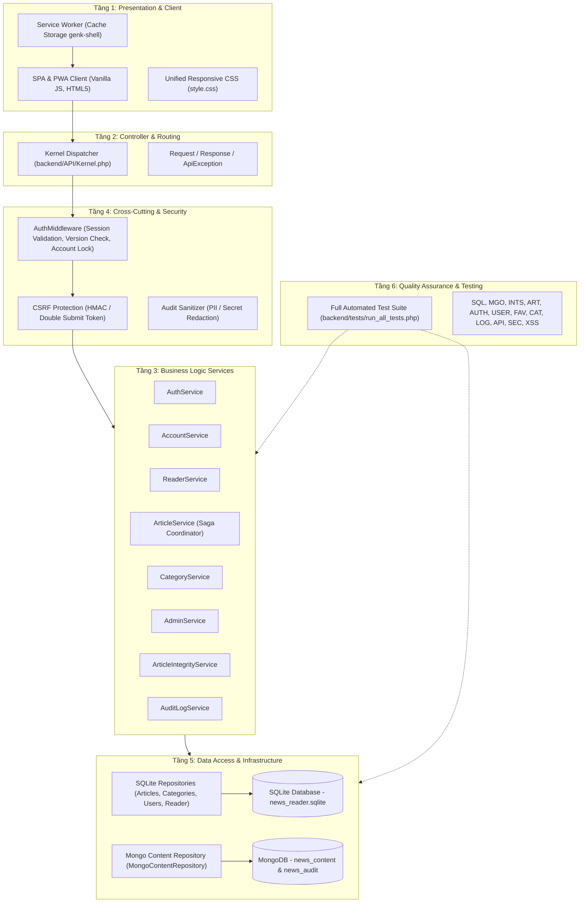
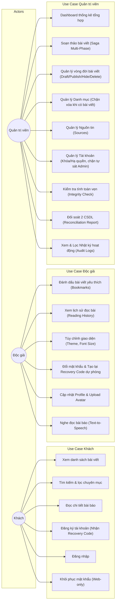
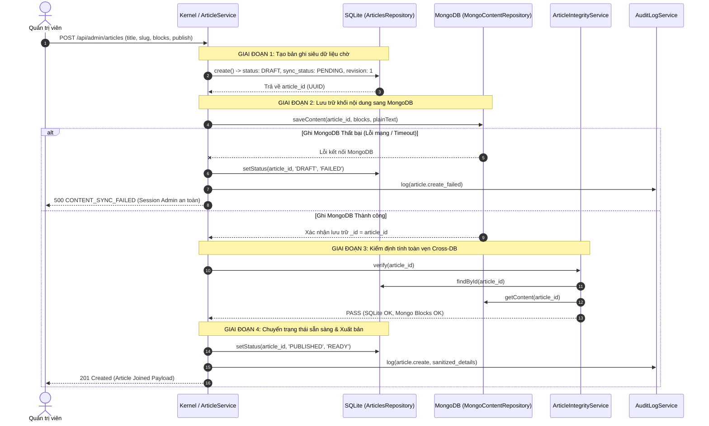

# KIẾN TRÚC HỆ THỐNG GENK MAGAZINE (SYSTEM ARCHITECTURE)

## 1. TỔNG QUAN HỆ THỐNG

**Genk Magazine** là nền tảng báo điện tử hiện đại, ứng dụng kiến trúc lai (Hybrid Persistence Architecture) kết hợp giữa CSDL quan hệ **SQLite** và CSDL tài liệu **MongoDB**, kết hợp Progressive Web App (PWA) để tối ưu hóa hiệu năng đọc báo offline, độ tin cậy và khả năng mở rộng.

---

## 2. KIẾN TRÚC 6 TẦNG (6-TIER ARCHITECTURE)

Hệ thống được tổ chức phân tách trách nhiệm nghiêm ngặt theo 6 tầng:



---

## 3. SƠ ĐỒ USE CASE HỆ THỐNG



---

## 4. LUỒNG ĐỒNG BỘ DỮ LIỆU SAGA 2 GIAI ĐOẠN (TWO-PHASE ARTICLE SAGA)

Nhằm giải quyết triệt để rủi ro dữ liệu mồ côi và bất nhất giữa 2 CSDL khác biệt (SQLite và MongoDB), quy trình tạo/xuất bản bài viết được thực thi theo mô hình Saga Orchestration:



---

## 5. CƠ CHẾ KHÓA LẠC QUAN (OPTIMISTIC CONCURRENCY CONTROL)

Để ngăn chặn hai Quản trị viên cùng mở màn hình chỉnh sửa bài báo và ghi đè nội dung của nhau:
1. Mỗi bài viết trong SQLite sở hữu thuộc tính số nguyên `revision` (khởi đầu là 1).
2. Khi Quản trị viên cập nhật, request mang theo `expected_revision`.
3. Câu lệnh SQL thực thi:
   ```sql
   UPDATE articles 
   SET title = ?, revision = revision + 1, updated_at = ...
   WHERE article_id = ? AND revision = ?;
   ```
4. Nếu số dòng thay đổi bằng 0 và bài viết tồn tại `revision` khác:
   Hệ thống từ chối cập nhật và trả về ngay **HTTP 409 Conflict** (`REVISION_CONFLICT`), yêu cầu Quản trị viên tải lại dữ liệu mới nhất trước khi chỉnh sửa.
